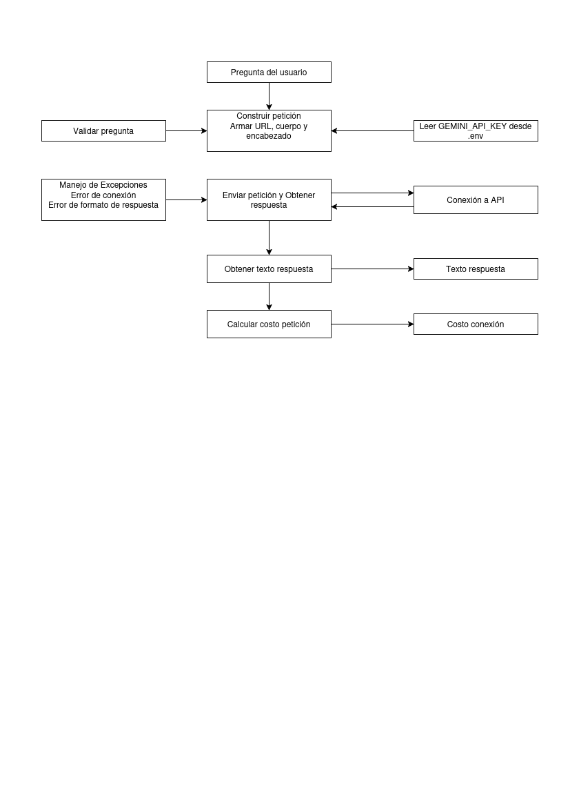

# Decisión de arquitectura: elección de modelo
  
 ## Modelo elegido:
Gemini 3.6 Flash
  
 ## Diagrama de arquitectura:
 
  
 ## Comparación de candidatos
 | Criterio | Gemini 3.5 Flash Lite | Gemini 3.6 Flash|
 |---|---|---|
 |Precio por millon de tokens de entrada [US$]|0.3|0.75|
 |Precio por millon de tokens de salida [US$]|2.5|3.75|
 |Latencia promedio observada [s]|1.504|2.286|
 |Calificación de la respuesta |Media rápida pero muy general|Buena mas lenta pero muy completa y detallada|

 ## Justificación:
Frente a la pregunta ¿Como se calcula una estructura hiperestática? en tres repeticiones, las respuestas fueron bastantes completas y coherentes. Para la aplicación que se desea el tiempo no es tan relevante como la coherencia y exactitud de la respuesta entregada 
  
 ## Alternativa descartada y por qué
 El modelo Gemini 3.5 Flash Lite tiene tiempos de respuestas mas cortos pero las respuestas son muy resumidas y muy generales para los efectos del tipo de aplicación que se esta desarrollando